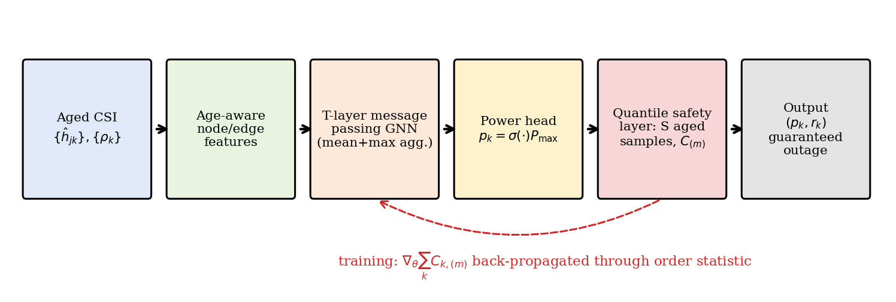

# AgeGuard

Code for the paper

> **Conformally Calibrated Graph Neural Power Allocation under Aged Channel State Information**
> G. Arul Dalton, Saveetha Engineering College, Chennai, India
> Submitted to *Wireless Networks* (Springer), 2026.

AgeGuard allocates transmit power in dense wireless interference networks when the channel state information (CSI) is outdated by a different amount at each receiver. It guarantees that the packet outage probability stays below a target ε.

## Method in brief



| Component | What it does | Paper | Code |
|---|---|---|---|
| CSI aging model | Each receiver's estimate is correlated with the true channel by ρ_k = J0(2π f_D,k τ_k) (Jakes model). | Sec. 3, Eq. (2) | `core.gen_instances`, `core.sample_true_gains` |
| Age-aware GNN | Message-passing graph neural network mapping aged gains and the age profile ρ to transmit powers. | Sec. 4.1, Eqs. (6)–(9), Fig. 3 | `core.feats`, `core.init_gnn`, `core.gnn_forward` |
| Quantile safety layer | Sets each link's rate to the m-th order statistic of S sampled capacities, so outage ≤ m/(S+1) ≤ ε (Prop. 1). A PAC variant bounds per-decision outage (Prop. 2). | Sec. 4.2, Eq. (10) | `core.quantile_rate`, `core.order_index` |
| Unsupervised training | Back-propagates the safe sum rate through the order statistic (Algorithm 1). | Sec. 4.3, Eq. (11) | `train.train` |
| Conformal recalibration (RC) | Scales all rates by ĉ, an order statistic of observed-to-predicted capacity ratios from N calibration networks. Outage ≤ ε even when the aging model is wrong (Prop. 3, Algorithm 3). | Sec. 4.5, Eqs. (12)–(13) | `recalibration.cal_scores`, `recalibration.conformal_c` |
| Online recalibration (OR) | Updates log ĉ from ACK/NACK feedback after every interval, with a long-run outage guarantee (Prop. 4, Algorithm 4). | Sec. 4.5, Eq. (14) | `recalibration.py` (online section) |

Baselines (`evaluate.py`): full power, WMMSE on aged CSI, WMMSE and full power with the safety layer, age-aware WMMSE on conditional mean gains, a GNN trained under perfect CSI, and a per-instance stochastic optimizer (Q-Opt, `evalu.qopt`).

## Repository structure

```
AgeGuard/
├── core.py                  system model, CSI aging, GNN, safety layer, WMMSE
├── evalu.py                 evaluation on fresh true-channel draws, Q-Opt baseline
├── train.py                 unsupervised training through the safety layer (Algorithm 1)
├── train_models.py          trains the 4 GNN models used in the paper     -> models.pkl
├── evaluate.py              all main experiments (Tables 2-7, Figs. 5-11) -> results.pkl
├── benchmark_latency.py     per-decision latency (Table 6)                -> bench.pkl
├── recalibration.py         Algorithms 3-4, Tables 8-9                     -> recal.pkl
├── make_figures.py          Figs. 1-2 and 5-11
├── make_recal_figures.py    Figs. 12-13
├── make_diagrams.py         block diagrams, Figs. 3-4
├── export_numbers.py        every number quoted in the paper              -> N.json
├── demo.py                  end-to-end demo with the pretrained model (<1 min)
├── reproduce.sh             runs the full pipeline (~1 hour, 1 CPU core)
├── pretrained/
│   └── ageguard_main.pkl    trained AgeGuard model used in the paper (96k parameters)
├── results/
│   ├── README.md            headline tables of the paper
│   └── recal.pkl            recalibration results (Tables 8-9, Figs. 12-13)
├── figures/                 all 13 paper figures (Fig01 ... Fig13)
├── docs/
│   └── IMPLEMENTATION.md    detailed code documentation and paper-to-code mapping
├── tests/
│   └── test_core.py         shape checks and numerical checks of Propositions 1 and 3
├── requirements.txt
├── CITATION.cff
└── LICENSE
```

## Installation

Tested with Python 3.12 on Linux, CPU only. No GPU is needed.

```bash
git clone https://github.com/GArulDalton/AgeGuard.git
cd AgeGuard
python -m venv .venv && source .venv/bin/activate      # optional (Windows: .venv\Scripts\activate)
pip install -r requirements.txt
```

## Quick demo (under 1 minute)

```bash
python demo.py            # uses the pretrained model in pretrained/
python demo.py --train    # trains a small model from scratch instead (1-2 min)
```

Expected output with the pretrained model:

```
WMMSE, naive rate            sum goodput  37.38 bps/Hz   outage 0.529
WMMSE + safety layer         sum goodput  61.30 bps/Hz   outage 0.046
AgeGuard                     sum goodput  63.37 bps/Hz   outage 0.046

True Doppler = 2 x assumed Doppler:
AgeGuard (model only)        sum goodput  52.46 bps/Hz   outage 0.189
conformal back-off factor c_hat = 0.753
AgeGuard + recalibration     sum goodput  48.65 bps/Hz   outage 0.039
```

The first block uses a correct aging model: AgeGuard meets the 0.05 outage target with more goodput than WMMSE. In the second block the channel ages twice as fast as assumed: the model-only outage rises to about 0.19, and conformal recalibration brings it back below 0.05.

## Tests

```bash
python tests/test_core.py      # or: pytest tests/
```

The tests check array shapes and the order index, and check numerically that the safety-layer outage matches Proposition 1 and the conformal back-off satisfies Proposition 3 (about 30 s).

## Reproducing the paper

Run everything (about 1 hour on a single CPU core):

```bash
./reproduce.sh
```

Or run the steps individually:

| Step | Command | Time (1 CPU core) | Produces |
|---|---|---|---|
| 1 | `python train_models.py` | ~25 min | `models.pkl` (AgeGuard, perfect-CSI GNN, no-age-feature ablation, 1-layer ablation) |
| 2 | `python evaluate.py` | ~20 min | `results.pkl` |
| 3 | `python benchmark_latency.py` | ~1 min | `bench.pkl` |
| 4 | `python make_figures.py` | <1 min | Figs. 1–2, 5–11 |
| 5 | `python export_numbers.py` | <1 min | `N.json` |
| 6 | `python recalibration.py` | ~6 min | `recal.pkl` |
| 7 | `python make_recal_figures.py` | <1 min | Figs. 12–13 |
| 8 | `python make_diagrams.py` | <1 min | Figs. 3–4 |

`train_models.py` is resumable: if it stops, rerunning it skips models that are already in `models.pkl`.

### Where each result comes from

| Paper item | Content | Source |
|---|---|---|
| Table 1 | Simulation and training parameters | `core.P`, `train.train` defaults |
| Figs. 1–2 | System model, AgeGuard pipeline | `make_figures.py` (`fig1_system.png`, `fig2_arch.png`) |
| Figs. 3–4 | GNN architecture, recalibration lifecycle | `make_diagrams.py` |
| Algorithms 1–2 | Training and inference | `train.train`, `core.gnn_forward`, `core.quantile_rate` |
| Algorithms 3–4 | Split conformal and online recalibration | `recalibration.cal_scores`, `recalibration.conformal_c`, online section of `recalibration.py` |
| Fig. 5 | Training curves | `fig3_conv.png` |
| Table 2, Fig. 6 | Main comparison, per-link CDF | `results.pkl['main']`, `fig7_cdf.png` |
| Table 3 | Paired Wilcoxon tests | `export_numbers.py` (`tab_stat`) |
| Table 4, Fig. 7 | Mobility sweep | `results.pkl['vsweep']`, `fig4_doppler.png` |
| Fig. 8 | Network size K = 10–40 | `results.pkl['ksweep']`, `fig5_K.png` |
| Fig. 9 | Outage target ε | `results.pkl['esweep']`, `fig6_eps.png` |
| Text (Sec. 6.5) | Sample budget S | `results.pkl['ssweep']` |
| Table 5, Fig. 10 | PAC variant | `results.pkl['pac']`, `fig8_pac.png` |
| Table 6 | Latency | `bench.pkl` |
| Fig. 11 | Doppler mismatch, model only | `results.pkl['mis']`, `fig9_mis.png` |
| Table 7 | Ablations | `results.pkl['abl']` |
| Table 8, Fig. 12 | Recalibration under mismatch | `recal.pkl['sweep']`, `fig10_recal.png` |
| Table 9 | Calibration set size N | `recal.pkl['ncal']` |
| Fig. 13 | Online ACK/NACK recalibration | `recal.pkl['aci']`, `fig11_online.png` |

All random seeds are fixed in the scripts, so reruns on the same software versions reproduce the reported numbers. To skip training, `recalibration.py` uses `pretrained/ageguard_main.pkl` automatically when `models.pkl` is absent. Detailed documentation of every function is in [`docs/IMPLEMENTATION.md`](docs/IMPLEMENTATION.md), and headline tables are in [`results/README.md`](results/README.md).

## Default settings

| Parameter | Value |
|---|---|
| Area / Tx–Rx distance | 500 m × 500 m / U[10, 50] m |
| Path loss | 35.3 + 37.6 log10(d) dB, Rayleigh fading |
| P_max / noise | 20 dBm / −95 dBm |
| Carrier / CSI delay | 3.5 GHz / U[0.5, 2] ms |
| Receiver speed | U[0, v_max]; v_max = 30 km/h at test, 60 km/h in training |
| Links K | 20 for training; 10–40 at test |
| Outage target ε / samples S | 0.05 / 64 (499 in the recalibration study) |
| GNN | 3 message-passing layers, hidden size 64, GELU, mean + max aggregation |
| Training | Adam, learning rate 1e-3 with cosine decay, 3,000 iterations, batch 32 fresh networks |
| Recalibration | N = 200 calibration networks; online step size η = 0.05 |

## Using AgeGuard in your own code

```python
import jax, jax.numpy as jnp
from core import gen_instances, feats, gnn_forward, sample_true_gains, quantile_rate
from train import train

params, _ = train(K=20, steps=3000, vmax=60.0)                 # Algorithm 1
snr, h, rho = gen_instances(B=10, K=20, seed=1, vmax_kmh=30.0)  # aged estimates + age profile
snr, h, rho = map(jnp.array, (snr, h, rho))

p = gnn_forward(params, *feats(snr, h, rho))                   # powers in [0, 1] x P_max
G = sample_true_gains(jax.random.PRNGKey(0), snr, h, rho, 64)  # S = 64 aged channel samples
r = quantile_rate(G, p, eps=0.05)                              # rates with outage <= 0.05 (Prop. 1)
# PAC variant (Prop. 2): quantile_rate(G, p, eps=0.05, delta=0.1)
# Conformal recalibration (Prop. 3): r_final = c_hat * r, with c_hat from recalibration.conformal_c
```

Array conventions: `snr[b, j, k]` is P_max·β_jk/σ² from transmitter j to receiver k, `h` holds the aged small-scale estimates, `rho[b, k]` is the aging coefficient of receiver k, and powers are fractions of P_max.

## Citation

If you use this code, please cite:

```bibtex
@article{aruldalton2026ageguard,
  author  = {G. Arul Dalton},
  title   = {Conformally Calibrated Graph Neural Power Allocation under Aged Channel State Information},
  journal = {Wireless Networks},
  year    = {2026},
  note    = {Submitted}
}
```

## License

MIT License. See `LICENSE`.

## Contact

G. Arul Dalton, Department of Computer Science and Engineering, Saveetha Engineering College, Chennai, India: garuldalton@gmail.com
